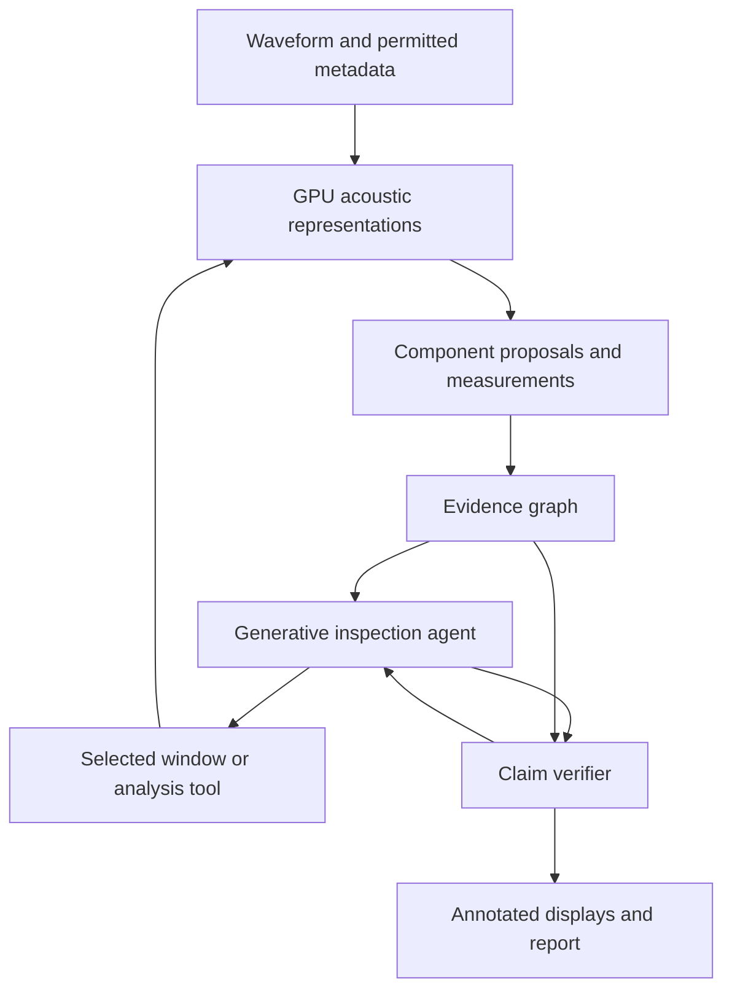

# Evidence-Grounded Agentic Interpretation of Underwater Acoustic Spectrograms

## Research methodology and GPU experimental plan

Prepared for Alex Mantzaris. Research and access-page review: November 16, 2026.

**Working subtitle:** Adaptive inspection of overlapping acoustic components using LOFAR and DEMON displays.

**Document status:** A proposed research protocol, not an experimental report. Numerical settings below are initial design choices to freeze after a training/validation pilot. No performance improvements have been measured, no GPU experiments have been run, and full dataset downloads have not been verified. This plan does not assume a particular conference or its page limit.

## 1. Recommended paper and central claim

Develop an agent that examines underwater acoustic recordings through two linked displays, selects additional time and frequency regions to inspect, measures the relevant acoustic structure, and produces an annotated interpretation whose claims point to identifiable evidence.

The two principal displays should be:

1. **A frequency-versus-time spectrogram, including a low-frequency LOFAR view**, for tones, harmonic families, drifting tracks, transients, bandwidth, and received level.
2. **A DEMONgram**, showing how envelope modulation frequencies change over time, computed for explicitly selected acoustic carrier bands.

The agent should produce both a structured scene description and a readable explanation. It should identify which observations are reliable, which physical interpretations remain hypotheses, which components overlap, and which cannot be assigned confidently to a source.

**Proposed central research question:** Does adaptive, measurement-grounded inspection of linked acoustic and modulation displays improve component localization, overlap interpretation, and explanation reliability compared with fixed-view and fixed-inspection systems using the same backbone and comparable compute?

This is a passive underwater acoustic interpretation study. Public recordings of vessel noise and ambient sound support this scope. Results would not establish performance on active-sonar echoes, submarine identification, source range estimation, or operational naval systems.

### 1.1 Three methodological contributions to pursue

| Contribution | Concrete mechanism | Evidence needed to justify it |
| --- | --- | --- |
| Adaptive acoustic inspection | A generative agent selects time windows, frequency ranges, analysis resolutions, and DEMON carrier bands based on unresolved hypotheses and conflicting evidence | Better grounded-event performance than fixed, random, and deterministic adaptive inspection under matched budgets |
| Overlap-preserving evidence representation | A graph retains multiple component tracks and hypotheses in the same region, links observations across views, and records uncertain associations | Improved overlap/relationship scores and fewer false source assignments, particularly on naturally overlapping recordings |
| Measurement-grounded generation and verification | Numeric claims are attached to tool measurements; unsupported claims are revised or withheld; explanations expose evidence IDs | Higher supported-claim precision without collapsing coverage, plus appropriate responses to controlled evidence changes |

The anticipated advantage is a more inspectable and adaptable interpretation process. The paper must test this advantage; attractive explanations and annotated pictures alone do not demonstrate it.

### 1.2 What the agent should actually answer

Examples of evaluation questions:

- Which persistent narrowband components occur between 5 and 25 seconds, and how do their frequencies change?
- Does a later transient overlap an existing tonal track, or does the tonal component end first?
- Which lines plausibly form a harmonic family, and what competing assignments remain?
- Is a visible increase caused by higher received band power, a plotting normalization change, or unresolved overlapping energy?
- Is there a persistent modulation peak in one or several carrier bands, and during which intervals?
- Does the evidence support a possible propulsion-related modulation pattern, or only an unexplained periodic envelope?
- What additional region or measurement would most help resolve the ambiguity?

Use these questions as fixed task categories, not as prompts that reveal the correct answer or the target location.

## 2. Relationship to existing work and defensible novelty

The literature already contains combined LOFAR/DEMON analysis, generative underwater acoustic descriptions, and VLM interpretation of bioacoustic spectrograms. Consequently, neither using two views nor adding an LLM is sufficient novelty.

| Closely related work | What the reviewed source establishes | Consequence for this paper |
| --- | --- | --- |
| Li, Song, and Feng, 2022, *Combined LOFAR and DEMON Spectrums for Simultaneous Underwater Acoustic Object Counting and F0 Estimation* [R1] | Combines the representations with a CRNN for counting and frequency estimation | Cite as direct signal-processing precedent. Do not claim that representation fusion or multiple-source counting is new |
| *Marine vessels acoustic classification with enhanced machinery and propeller feature extraction, using convolutional neural network*, 2026 [R2] | Uses LOFAR/DEMON feature fusion for vessel classification | Include a strong learned dual-view baseline |
| Nihal et al., 2025, *Knowledge-Augmented Vision Language Models for Underwater Bioacoustic Spectrogram Analysis* [R3] | Studies VLM pattern descriptions and knowledge augmentation for marine mammal classification | Distinguish localized numeric evidence and adaptive tool use from description-based pattern matching |
| Zhang et al., 2026, *From Signals to Evidence*, Part I [R4] | The indexed primary abstract describes physics-aware encoding, an LLM, structured physical descriptions, and simulated-vessel evaluation | Treat as very close prior work. Real-data grounding and adaptive inspection must be demonstrated, not assumed to distinguish the method |
| Li et al., 2026, *From Signals to Evidence*, Part II [R5] | The indexed primary abstract describes multichannel evidence and structured passive detection reports | Do not claim the first physical-evidence reasoning system for underwater detection |
| Sun et al., 2026, UA-Bench [R6] | The authors' repository describes a synthetic underwater audio-language benchmark, hierarchical labels, and silence controls | Add controls that test whether acoustic evidence changes outputs; keep the main evidence on real data |
| Yao et al., 2023, ReAct [R7] | Establishes interleaving language-model decisions with external actions | Cite the general agent pattern. The contribution must be the acoustic formulation and its measured value |

**Novelty position to defend:** A budgeted agent that adaptively interrogates overlapping acoustic structures, maintains traceable relations between acoustic-frequency and modulation-frequency evidence, and is evaluated for localized explanation reliability on predominantly real recordings.

This is a candidate contribution, not a verified first-in-literature claim. The full text of the October 2026 Part I/II papers could not be retrieved from arXiv during this review; their primary indexed abstracts were available. Obtain and examine both papers and any code before finalizing the manuscript's novelty language. Do not infer that a feature is absent merely because it was absent from an abstract.

Do not make signal regeneration, audio synthesis quality, or a large new foundation model a second central contribution. Synthetic signals serve controlled testing and limited supervision here.

## 3. The second operator display: choices and interpretation

DEMON, usually expanded as Detection of Envelope Modulation on Noise, analyzes the envelope of band-limited noise. A DEMONgram is a time-varying modulation spectrum. It can reveal periodic structure complementary to ordinary spectral lines [R1, R8].

It is a strong choice for this study, but it cannot establish which display the user remembers. Other common possibilities should be acknowledged:

| Display | Axes or quantity | Role in this project |
| --- | --- | --- |
| LOFARgram / low-frequency spectrogram | Time and acoustic frequency | Core view for persistent lines and spectral structure |
| DEMONgram | Time and envelope modulation frequency, for a specified carrier band | Core complementary view for periodic envelope structure |
| Averaged spectrum / PSD | Acoustic frequency and power spectral density | Supporting measurement tool for peak spacing and band power |
| Waveform / level history | Time and amplitude or received level | Supporting tool for onsets, amplitude changes, and clipping |
| Bearing-time display | Time and estimated direction | Future extension requiring suitable array recordings and sensor geometry |

A LOFARgram is a kind of spectrogram, not an independent second physical modality. Both LOFAR and DEMON are derived from the same recording, so their evidence is correlated. Do not multiply their confidence scores as though they were independent observations.

**Critical axis distinction:** A 12 Hz DEMON peak is a 12 Hz envelope modulation. It is not automatically the same phenomenon as a 12 Hz acoustic tone in a LOFARgram. The interface must always display units and the DEMON carrier band.

## 4. Real datasets, access status, and recommended use

### 4.1 Dataset shortlist

These are research sources verified through provider pages, author repositories, or primary papers. "Available link" means a provider route was found, not that all files were downloaded or decoded.

| Dataset and direct source | Relevant content | Access and limitations observed | Proposed role |
| --- | --- | --- | --- |
| **DeepShip**: [author repository](https://github.com/irfankamboh/DeepShip) [R9] | Provider reports 47 h 04 min from 265 vessels, with cargo, passenger, tanker, and tug classes | Repository supplies part of the data and directs researchers to request the remainder. Verify the received release, recording IDs, and license; whole-recording labels do not provide component boxes | Preferred principal vessel corpus if complete access is obtained; use original continuous recordings for temporal analysis |
| **QiandaoEar22**: [author repository](https://github.com/xiaoyangdu22/QiandaoEar22), [paper](https://doi.org/10.1186/s13634-024-01181-9) [R8, R10] | Provider reports 9 h 28 min of real ship noise and 21 h 58 min of background; deliberately includes multiple simultaneous targets | Repository links to an external dataset folder. Verify download and original session structure. Published labels identify particular targets, not all contributing components | Essential real-overlap corpus; label observable components independently. Describe the freshwater lake domain explicitly |
| **ShipsEar**: [Universidade de Vigo database](https://underwaternoise.atlanttic.uvigo.es/) [R11] | Real shallow-water recordings and collection metadata, including vessel type, gain, position, and approximate distance | Public samples are offered; the provider requests contact for full access. Do not assume samples constitute the full benchmark | Independent marine-domain test if access is obtained; preserve its original labels before defining any mapping |
| **UniqueShip**: [dataset portal](https://uniqueshipdata.org/) [R12] | Provider offers vessel-disjoint folds, AIS metadata, background examples, and several dataset sizes | Released clips are 5 s at 20 kHz; the provider describes access to longer recordings through its codebase. Provider states CC BY 4.0 for the underlying ONC data | Useful scalable classification/control corpus. Long-window reasoning requires verified continuous source reconstruction |
| **MBARI Pacific Sound**: [Open Acoustic Data](https://www.mbari.org/project/open-acoustic-data/) [R13] | Continuous real marine soundscapes, with lower-rate versions and access documentation | Not a ready-made vessel component benchmark. Select and annotate bounded recordings. Use a bandwidth sufficient for the intended DEMON carrier bands | Accessible fallback for real temporal scenes, ambient sound, and out-of-domain morphology evaluation |
| **DeuteroNoise**: [author preview](https://github.com/Ignasinou/deuteronoise-dataset-preview), [paper](https://doi.org/10.1016/j.apacoust.2026.111239) [R14, R15] | Paper describes nearly 700 h of calibrated multi-basin audio and more than 11 h of labelled audio, with AIS associations | Preview repository describes a sample release; the full project site could not be accessed in this review, and the publisher's data statement says data are available on request | Valuable optional test of cross-basin transfer and calibrated received level. Do not make completion depend on full access |
| **NOAA DCLDE 2013**: [official metadata](https://data.noaa.gov/metaview/page?view=getDataView&xml=NOAA%2FNESDIS%2FNGDC%2FMGG%2Fpassive_acoustic%2F%2Fiso%2Fxml%2FDCLDE_2013.xml) [R16] | Annotated real baleen-whale acoustic data | Check annotation granularity and release terms before adopting. It is not a vessel dataset | Optional biological-confound extension, not required for the core conference paper |

### 4.2 Recommended acquisition order and fallback

1. Audit the accessible original recordings from DeepShip and QiandaoEar22 first, including duration, channels, labels, bandwidth, and grouping metadata.
2. Determine full-access status for DeepShip and ShipsEar early. A future executor should report requests needed; it should not claim to have obtained unavailable files.
3. Prepare a bounded MBARI selection to guarantee an additional source of continuous real soundscapes.
4. Use UniqueShip only after checking source overlap with other ONC-derived data and determining whether the available durations support the task.
5. Add DeuteroNoise only when actual audio, calibration, metadata, and permissions are confirmed.

**Minimum viable data requirement:** Two independent real recording domains, usable continuous scenes, naturally overlapping examples, and enough independently annotated regions for a meaningful held-out test. If long recordings cannot be recovered from a clip dataset, use those clips only for short-window tasks. Never concatenate unrelated clips to manufacture a "real" temporal scene.

Fallback order for the main temporal corpus: DeepShip original recordings; then QiandaoEar22 original sessions plus MBARI scenes; then another verified continuous real corpus. The fallback may change the available vessel-class task, but must preserve the component-grounding task and real-data majority.

DeepShip and UniqueShip are not automatically independent datasets: both draw from Ocean Networks Canada. Audit shared dates, hydrophones, vessel IDs, source intervals, and near-duplicate audio. A cross-dataset result with shared passages is not a valid external-generalization result.

### 4.3 Access and license manifest

For every accepted release, store provider URL, dataset version, acquisition date, file hashes, original identifiers, grouping metadata, license/terms, citation, calibration availability, and whether derived annotations may be redistributed. A code repository's license does not automatically license its linked audio.

Verify byte access, audio decoding, sampling rate, duration, channels, and annotation alignment before freezing the dataset choice. This planning task has verified source descriptions, not completed these acquisition checks.

## 5. Benchmark construction and ground truth

### 5.1 Unit of analysis

Use a **scene** of approximately 30 s by default, with 10-60 s duration allowed where the source supports it. Each scene refers to one exact interval in a continuous original recording. The agent may inspect overlapping subwindows of 2, 4, 8, and 16 s plus the complete scene, subject to actual duration.

Short events receive short-window analysis; slowly varying or closely spaced tones require longer windows. Store original time coordinates throughout. A cropped view must not reset the event's absolute identity or turn an overlapping crop into a new independent sample.

For larger weakly supervised classifier training, use 5-10 s segments extracted **after** grouping and splitting. The dense reasoning benchmark is separate from this larger classification pool.

### 5.2 Preferred dense benchmark size

| Data stratum | Train scenes | Validation scenes | Test scenes | Total | Ground truth |
| --- | ---: | ---: | ---: | ---: | --- |
| Untouched real recordings | 300 | 100 | 200 | 600 | Independent human acoustic annotations, with explicit uncertainty |
| Controlled mixtures of held-apart real recordings | 50 | 20 | 30 | 100 | Known mixture provenance and timing; source excerpts retain their internal complexity |
| Fully synthetic controlled signals | 50 | 20 | 30 | 100 | Exact generating tracks, events, envelopes, and mixing parameters |
| **Total** | **400** | **140** | **260** | **800** | Report each stratum separately |

Thus, 75% of unique scenes are untouched real recordings, and approximately 77% of the main test scenes are untouched real recordings. The real-only test is the primary evidence; synthetic results must not be pooled into the headline to improve an average.

An illustrative allocation of the 600 real scenes is 400 DeepShip scenes (250/75/75), 100 QiandaoEar22 scenes (50/25/25), and 100 external marine scenes used only for testing. Those external scenes come from ShipsEar and/or a preselected MBARI subset, according to access and task suitability. Freeze the allocation before any test inference. If source counts cannot support it, reduce the allocation and document the reason rather than relaxing independence.

The 200 real test scenes would then comprise 100 tests from held-out groups in development domains and 100 tests from wholly held-out domains. Report those groups separately. An external morphology test need not have the same vessel-class labels as the training corpus.

**Smaller feasible version:** 360 real scenes (180/60/120), 60 real-mixture scenes (30/10/20), and 60 synthetic scenes (30/10/20), totaling 480 scenes. Preserve the same real fraction, external testing, and annotation standards. Reduce optional experiments before reducing annotation quality.

### 5.3 Leakage prevention

- Split at the highest reliable independence level before segmentation: vessel identity where available, then recording session/pass, deployment/day, and original recording. A vessel-disjoint claim requires actual vessel identifiers.
- If these grouping factors connect several recordings, assign the connected group to one split. Do not independently split overlapping excerpts.
- When only recording IDs exist, describe the protocol as recording-disjoint, not vessel-disjoint.
- Keep all transformations, crops, mixtures, and noisy versions of a source interval in its assigned split. A mixture may only use parent recordings and background material from that same split.
- Freeze the test set before annotation-driven model development. Test annotators can see test audio; the model developer cannot use those labels for tuning.
- Fit normalization statistics, candidate thresholds, confidence calibration, demonstrations, retrieval examples, and hyperparameters on training/validation only.
- Remove class names, ship names, AIS type fields, and label-bearing filenames from the agent input. Metadata needed for ground truth is not automatically permissible input.
- Check exact hashes and GPU-computed near-duplicate waveform/spectral similarity across sources. Treat a common ONC origin as a reason for a specific overlap audit.
- Limit dense annotation to a small number of scenes per original group; target at least 60 independent groups in the real test when the corpus permits. Report the achieved number rather than counting scenes as independent vessels.

### 5.4 Annotation ontology

Keep **observable acoustic form**, **source identity**, and **physical interpretation** separate.

| Layer | Example fields | Allowed interpretation |
| --- | --- | --- |
| Observed component | Persistent tone, harmonic family, drifting ridge, broadband event, short transient, periodic envelope, unresolved overlap | Directly annotatable from sound and displays |
| Geometry and dynamics | Start/end time, frequency limits, ridge points, bandwidth, slope, onset, interruption, recurrence | Numerical values with resolution-dependent tolerances |
| Relationships | Temporal overlap, time-frequency overlap, possible harmonic relation, continuation, possible shared source, competing association | Multiple relationships may coexist; uncertain edges remain uncertain |
| Source category | Dataset-supported vessel category, biological signal, ambient/background, unknown | Only as specific as independent labels permit |
| Physical explanation | Possible machinery-related tones, possible propulsion-related modulation, interference/beat alternative | Hypotheses unless independently supported by instrumentation or authoritative source metadata |

A recording labelled "cargo ship" does not prove that every line in it was generated by that ship. Likewise, a harmonic family does not by itself identify a machine, shaft speed, or number of propeller blades.

### 5.5 Annotation procedure and resource requirement

1. Write a short annotation guide using training examples. Specify box versus ridge annotation, minimum audibility/visibility, uncertainty tags, and overlap conventions.
2. Have two annotators independently annotate all test scenes and a development subset; ideally annotate all 600 real scenes twice. At least one annotator should have underwater-acoustic expertise.
3. Hide model outputs and candidate source labels during the initial morphology annotation. Permit waveform playback and all required analysis displays.
4. Adjudicate disagreements, preserving the original annotations and an "unresolved" category. Do not force ambiguous source assignments.
5. Mark which time-frequency areas have been exhaustively annotated. Score false positives only against an appropriate exhaustive or verified region set; unlabelled structure is not automatically a negative.
6. Report agreement for event class, interval boundaries, ridge location, and relationships. Use agreement statistics suitable for each field, not one global number.

Planning allowance: if one scene takes 5-10 minutes per annotator, double annotation of 600 real scenes requires roughly 100-200 person-hours before adjudication. This arithmetic is a workload estimate, not a measured annotation speed. This is likely a larger constraint than initial GPU preprocessing.

If no qualified acoustic annotator is available, keep the real-data claims at observable morphology and state the limitation. Synthetic labels or an LLM judge cannot replace independent validation of real physical source interpretations.

## 6. Mathematical formulation and acoustic representations

### 6.1 Observation and superposition

For one hydrophone, model the received waveform as

\[
x[n]=\sum_{j=1}^{J}(h_j*s_j)[n]+\eta[n],
\tag{1}
\]

where \(s_j\) is a source signal, \(h_j\) a propagation/filtering response, and \(\eta\) the remaining background. This is an analysis model, not a promise that the individual sources are identifiable.

In a time-frequency bin, complex amplitudes add. Consequently,

\[
\left|\sum_j X_j\right|^2
=\sum_j|X_j|^2+2\sum_{i<j}\operatorname{Re}(X_iX_j^*).
\tag{2}
\]

Power is not exactly additive for coherent sources, and log-spectrogram intensities must never be added to simulate waveform mixtures. This matters when the agent reasons about overlapping components and apparent level increases.

### 6.2 Multi-resolution STFT and power

For resolution \(r\), define

\[
X_r[m,k]=\sum_{n=0}^{N_r-1}x[n+mH_r]w_r[n]
\exp(-\mathrm{i}2\pi kn/N_r).
\tag{3}
\]

Here \(N_r\) is the analysis length, \(H_r\) the hop, \(w_r\) a Hann window, \(f_k=kf_s/N_r\), and the frame time is the window center expressed in original-recording coordinates. Avoid hidden centering/padding offsets when converting frames to annotations.

Use a one-sided power spectral density,

\[
P_r[m,k]=\frac{c_k|X_r[m,k]|^2}{f_s\sum_n w_r[n]^2},
\qquad
L_r[m,k]=10\log_{10}\frac{P_r[m,k]+\epsilon}{P_{\mathrm{ref}}},
\tag{4}
\]

where \(c_k=2\) for interior positive-frequency bins and 1 for DC and Nyquist when applicable. \(P_{\mathrm{ref}}\) must have the same units as \(P_r\). Calibrated pressure data can use an acoustic reference; otherwise label the display with an explicit relative or digital-unit reference.

Maintain both the unwhitened level representation and a local-background representation,

\[
W_r[m,k]=10\log_{10}\frac{P_r[m,k]+\epsilon}
{\widehat B_r[m,k]+\epsilon}.
\tag{5}
\]

\(\widehat B_r\) is a robust local background estimate. Use \(W_r\) to reveal faint structure, but measure intensity changes from \(P_r\), not the whitened plot.

**Initial representation settings:**

| Representation | Starting configuration | Purpose |
| --- | --- | --- |
| Native-band overview | Original usable bandwidth; 0.25 s Hann windows, 75% overlap | Broadband components, high-frequency carriers, transients |
| Low-frequency branch | GPU anti-aliased resampling to 4 kHz where valid; plot 0-2 kHz | Machinery-like lines and low-frequency structure |
| Multi-resolution low-frequency views | 0.25, 1, and 4 s windows with 75% overlap | Approximate bin spacings of 4, 1, and 0.25 Hz, respectively |
| Short-event zoom | 0.064-0.125 s windows where needed | Onsets and brief events, accepting coarser frequency resolution |
| Averaged PSD | Selected interval, same physical normalization | Check peaks, spacing, sidebands, and band power |

Frequency-bin spacing is not the same as resolvability of two nearby tones; window shape, observation length, and SNR matter. Zero-padding does not create new resolving power. Never request a 4 s analysis window for a 2 s crop without explicitly handling its insufficient support.

### 6.3 DEMONgram construction

For a carrier band \(b=[f_b^-,f_b^+]\), compute the band-passed waveform and analytic envelope:

\[
u_b=\operatorname{BandPass}_b(x),\quad
z_b=u_b+\mathrm{i}\mathcal H(u_b),\quad
e_b=\operatorname{LPF}(|z_b|)-\operatorname{mean}(\operatorname{LPF}(|z_b|)).
\tag{6}
\]

Perform anti-aliased envelope decimation, then compute

\[
D_b[m,q]=\operatorname{PSD}_{\mathrm{STFT}}(e_b)[m,q].
\tag{7}
\]

The ordinate \(\nu_q\) is modulation frequency. Keep the envelope and its normalization metadata so a normalized DEMON display is not misused as a calibrated received-level estimate.

Starting carrier candidates are 0.5-2, 2-5, and 5-8 kHz, restricted to the actual usable bandwidth and filter transition margins. Start with envelope sampling at 500 Hz, plot 0.5-200 Hz, and use 4 s modulation windows with 0.5 s hops. Use shorter windows for shorter valid scenes, with the changed resolution disclosed. Carrier-band selection is an agent action; the bands are not universal acoustic constants.

Compute a DEMON window from a sufficiently padded waveform interval and trim filter boundaries. Never compute it merely by cropping the low-frequency spectrogram image. Missing carrier bandwidth must be represented as unavailable evidence, not silently replaced by zeros.

If a proposed interpretation involves shaft and blade-passing frequencies, the relation

\[
f_{\mathrm{blade}}=Bf_{\mathrm{shaft}}
\tag{8}
\]

is conditional on blade count \(B\) and the physical mechanism. A single modulation peak cannot determine both unknowns. Nearby interfering tones can also produce beating in an envelope; include this as an explicit competing explanation, especially in overlap scenes.

### 6.4 Component representation and intensity

Represent component \(i\) as

\[
v_i=(I_i,F_i,\Gamma_i,M_i,\boldsymbol\phi_i,
\boldsymbol p_i,\mathcal E_i),
\tag{9}
\]

where \(I_i\) is its time support, \(F_i\) its frequency extent, \(\Gamma_i\) an optional ridge trajectory, \(M_i(t,f)\) an optional mask, \(\boldsymbol\phi_i\) measured attributes, \(\boldsymbol p_i\) class probabilities, and \(\mathcal E_i\) evidence/provenance IDs. Store masks and intervals separately for acoustic and modulation domains.

Measured attributes should include duration, center frequency, bandwidth, frequency slope, harmonic spacing, intermittency, local contrast, band power, and modulation peaks where available. Include uncertainty and analysis resolution for each measurement.

For a region, estimate mean band power by integrating PSD over frequency and averaging over its selected frames:

\[
E_R=\frac{1}{|\mathcal T_R|}\sum_{m\in\mathcal T_R}
\sum_{k\in\mathcal F_R(m)}P[m,k]\,\Delta f.
\tag{10}
\]

Compare like-for-like frequency support when reporting changes. If desired, define local contrast as \(10\log_{10}[(E_R+\epsilon)/(E_{R,\mathrm{background}}+\epsilon)]\). This is a contrast statistic, not an exact source SNR in an unknown mixture.

For calibrated pressure, an optional received SPL is \(10\log_{10}(p_{\mathrm{rms}}^2/(1\,\mu\mathrm{Pa})^2)\). Uncalibrated files cannot support absolute SPL, source level, range, or emitted acoustic power. A louder received component does not prove that its source became more powerful.

### 6.5 Overlap and the evidence graph

Use \(G=(V,E)\), with component/measurement nodes and typed relations. Keep temporal overlap and time-frequency overlap distinct:

\[
o_t(i,j)=\frac{|I_i\cap I_j|}{\min(|I_i|,|I_j|)},\qquad
o_{tf}(i,j)=\frac{\sum\min(M_i,M_j)}{\sum\max(M_i,M_j)+\epsilon}.
\tag{11}
\]

Two components can coexist in time but occupy different frequency bands. Two ridges can cross without belonging to one source. One source can contribute many components.

Graph edge types: `continues`, `overlaps_time`, `overlaps_time_frequency`, `harmonic_candidate`, `modulation_support`, `possible_same_source`, `contradicts`, and `unresolved_association`.

Cross-view edges connect **overlapping time intervals, explicit carrier bands, and testable hypotheses**, not equal numeric frequency coordinates. Modulation evidence for an interval often cannot be attributed uniquely to one acoustic ridge. Preserve competing associations.

Repeated crops of the same structure are measurements of one possible event, not multiple independent observations. Merge only compatible duplicate tracks using time, frequency, and identity evidence. Do not apply global nonmaximum suppression that deletes valid overlapping events of different types or sources.

## 7. Proposed agent architecture

### 7.1 Components and information flow



The agent's state contains the current evidence graph, available views, unresolved questions, analysis history, and remaining budget. It does not contain test annotations, source filenames that encode labels, or hidden simulator parameters.

Use a local open-weight multimodal model on the RunPod GPU. **Qwen3-VL-8B-Instruct** is a concrete starting candidate; its publisher provides an image-text model card and Apache 2.0 license [R17]. Pin an exact revision after the compatibility pilot. Domain competence must be measured rather than inferred from generic visual performance.

The initial experiment can freeze the backbone, train the smaller perception heads, and use training-only examples in the agent prompt. This isolates the methodological loop without requiring an extensive instruction-tuning dataset. Optional LoRA tuning is a separate, clearly reported experiment.

### 7.2 Perception and component proposals

Use a compact dual-branch convolutional encoder, initially ResNet-18-scale, with separate LOFAR and DEMON inputs. Add:

- Scene-level classification heads for available dataset labels.
- A feature-pyramid or dense segmentation head for event morphology and boundaries.
- A ridge/peak proposal path from GPU spectral measurements, so detection is not wholly dependent on the learned model.
- A region head for morphology probabilities and uncertainty.

A practical initial loss is

\[
\mathcal L=\lambda_{\mathrm{scene}}\mathcal L_{\mathrm{scene}}
+\lambda_{\mathrm{event}}\mathcal L_{\mathrm{event}}
+\lambda_{\mathrm{mask}}\mathcal L_{\mathrm{mask}}
+\lambda_{\mathrm{track}}\mathcal L_{\mathrm{track}}.
\tag{12}
\]

Use cross-entropy for mutually exclusive scene classes, binary cross-entropy for multi-label event types, a Dice/BCE mask loss where masks exist, and robust coordinate loss for annotated tracks. Apply each term only where the corresponding annotation is available. Unknown real source associations must not become negative training labels.

Train first on larger weakly labelled real audio for scene features, then adapt morphology heads with the dense training set. Use loss normalization to stop the numerous weak labels from overwhelming localization. Start AdamW at approximately \(10^{-4}\) for new heads and \(10^{-5}\) for an unfrozen backbone, with early stopping on validation grounded-event performance. Tune these values only on development data.

### 7.3 Permitted agent actions

| Action | Input | Returned evidence |
| --- | --- | --- |
| `inspect_region` | Time interval, acoustic frequency interval, requested resolution | Crop plus exact coordinate transform and available measurements |
| `inspect_modulation` | Time interval, carrier band, modulation range | DEMONgram, peaks, uncertainty, filter details |
| `measure_peaks` | View/interval, peak specification | Peak frequencies, prominence, width, and resolution |
| `track_component` | Candidate ID and interval | Ridge estimates, continuation alternatives, missing segments |
| `compare_intervals` | Two or more windows, fixed band definition | Frequency drift, band-power change, persistence, and uncertainty |
| `test_harmonic_relation` | Candidate tracks and tolerances | Fit residuals, plausible fundamentals, competing assignments |
| `inspect_overlap` | Component IDs and shared interval | Time overlap, frequency overlap, and unresolved source links |
| `finalize_or_abstain` | Structured claims and evidence IDs | Validated report or explicit unresolved findings |

All signal transformations and learned inference run on GPU. Tools return measurements and provenance; they do not silently supply the correct scene label. The agent receives an explicit insufficient-support response if the requested analysis cannot be computed at the claimed resolution.

### 7.4 Adaptive inspection and budget

Let state \(s_k\) contain observations through step \(k\). The generative controller chooses

\[
a_k\sim\pi_\theta(a\mid s_k,\mathcal A_k),
\qquad s_{k+1}=\operatorname{Update}(s_k,\operatorname{Tool}(a_k)).
\tag{13}
\]

\(\mathcal A_k\) contains only valid actions. A practical proposal priority is

\[
U(R)=\alpha\overline H(R)+\beta C(R)+\gamma N(R)
-\delta D(R)-\lambda\widehat c(R),
\tag{14}
\]

where \(\overline H\) is normalized entropy of the learned region head, \(C\) is a normalized conflict score for comparable hypotheses, \(N\) measures uninspected structure, \(D\) penalizes duplicate inspection, and \(\widehat c\) predicts cost from the development pilot. Normalize terms to comparable scales. Start with equal positive priorities, then freeze validation-selected weights.

This is a transparent heuristic for prioritizing candidates, **not an exact information-gain estimate or a trained reinforcement-learning policy**. The agent may select among the highest-priority candidates and propose a justified valid alternative. Log its chosen action and a concise reason, such as "check whether the transient interrupts the existing ridge."

Keep a meaningful role for the generative controller: it selects the analysis in response to returned evidence, maintains competing hypotheses, and revises the report. A deterministic candidate schedule followed by prose generation is a required baseline.

Initial budget: global paired views, at most six inspection actions, at most two of them devoted to resolving a verification failure, and one final structured report. Test budgets of 2, 4, and 6 actions. Pilot and freeze maximum image resolution, visual-token allowance, context length, total generated tokens, and per-scene timeout. Count attempted/invalid calls and failed generations in the budget.

Stopping occurs when supported claims and known uncertainties stabilize, no useful candidate remains, or the budget is exhausted. Always report unresolved components rather than forcing certainty.

### 7.5 Cross-view consistency and verification

For each claim, record the observable being asserted, relevant interval/region, evidence IDs, measured value/range, resolution/tolerance, and whether it is an observation or an interpretation.

Examples of checks:

- A reported peak lies within its cited crop and agrees with the numerical measurement.
- A claimed rising track has measured positive slope beyond its uncertainty.
- A harmonic claim has several compatible measured peaks; it does not rest on arbitrary visual spacing.
- An overlap claim cites two distinct supported components, not duplicate crops of one track.
- A modulation claim identifies the carrier band and sufficient observation duration.
- A source-level claim does not exceed the dataset's labels or the available physical evidence.

Separate **schema validity**, **measurement consistency**, and **independently assessed correctness**. A report can pass internal checks while being wrong because its detector or physical hypothesis is wrong.

Use a small GPU confidence head trained on development claim features, then calibrated on validation data, if claim probabilities are needed. Features can include localization confidence, measurement uncertainty, harmonic fit, unresolved conflicts, and modality availability. Do not treat the language model's verbal confidence as calibrated probability.

**Make consistency checks executable.** For a claim relating measurements \(z_1,\ldots,z_p\), define its physical or geometric constraint \(g_c(\boldsymbol z)=0\), and evaluate a normalized residual

\[
r_c=\frac{|g_c(\boldsymbol z)|}{\tau_c(\boldsymbol z)+\epsilon},
\]

where \(\tau_c\) combines known measurement resolution and validation-selected tolerance in the same units as the residual. For a harmonic candidate, one possible constraint is \(g_c=f_\ell-\ell f_0\). For a continuity claim, compare the two ridge estimates only over their shared time support. Enumerate plausible harmonic indices on GPU and retain alternative fits when they are indistinguishable. A low residual establishes compatibility, not unique source identity.

Define the conflict term in Equation 14 as a bounded aggregate of residual violations for the comparable claims supported by region \(R\), for example the mean of \(\min(1,\max(0,r_c-1))\). Use zero when there are no evaluable constraints, and separately track missing evidence so absence is not interpreted as agreement. Do not compare acoustic frequency directly with modulation frequency unless a specific physical hypothesis defines the relation.

**One complete agent episode:**

1. Compute global representations and initial proposals on GPU; assign stable component/evidence IDs.
2. Initialize multiple allowed hypotheses, including unknown source and unresolved overlap.
3. Generate valid candidate inspections and calculate the priority terms from current measurements.
4. Let the controller choose an action and concise purpose under the remaining budget.
5. Execute the tool on the original waveform interval; return its view, measurements, units, and uncertainty.
6. Update compatible component tracks, retain conflicting assignments, and attach provenance without double-counting repeated observations.
7. Recheck affected claims and choose another inspection, finalize, or abstain.
8. Validate the final report and render only claims whose status is explicit. Save the complete action/evidence record.

### 7.6 Structured output contract

The following is an illustrative schema, not a real observation or experimental result:

```json
{
  "scene_id": "illustrative_scene",
  "recording_time_origin_seconds": 0.0,
  "components": [
    {
      "component_id": "C1",
      "morphology": "persistent_tonal_track",
      "time_interval_seconds": [4.0, 21.0],
      "acoustic_frequency_interval_hz": [118.0, 126.0],
      "source_assignment": "unknown",
      "physical_interpretation": "possible machinery-related tone",
      "interpretation_status": "hypothesis",
      "measurement_evidence_ids": ["E11", "E14"],
      "confidence": null
    }
  ],
  "relations": [],
  "claims": [
    {
      "claim_id": "Q1",
      "component_ids": ["C1"],
      "kind": "observation",
      "text": "A persistent tonal track is visible in the cited interval.",
      "evidence_ids": ["E11"],
      "verification_status": "measurement_consistent"
    }
  ],
  "unresolved_questions": ["Which source generated C1?"],
  "actions_used": 3
}
```

Add carrier-band and modulation-frequency fields to DEMON claims. Preserve all measurement records separately, including configuration, timestamps, units, and provenance. Text shown to users should be a concise rendering of this structured report. Evaluate the structured claims and their evidence rather than a hidden reasoning trace.

### 7.7 User-facing research viewer

Specify a small viewer with synchronized LOFAR and DEMON panels, a shared time cursor, and an evidence/report panel. Clicking a component highlights its boxes or ridge, all overlapping components, the cited DEMON interval/carrier band, and the relevant measurements. A user can select an overlapping interval and request a bounded reinspection with the same GPU tools.

Expose raw and background-normalized views as labelled options. Show observed features, proposed source interpretations, confidence when calibrated, and unresolved alternatives in separate fields. Provide a compact inspection history and permit correction of an annotation without overwriting the original prediction. Human corrections belong to an explicitly separate interaction experiment, not the frozen automatic benchmark.

A static HTML case viewer is sufficient for the first manuscript; a live interactive prototype is optional. The paired displays are complementary representations, not a claim that a spectrogram retains all waveform information. Preserve the waveform for phase-sensitive or additional analyses when justified.

## 8. Controlled mixtures and synthetic experiments

### 8.1 Mixtures of real recordings

Construct mixtures in the waveform domain:

\[
x_{\mathrm{mix}}[n]=a\,x_A[n]+b\,x_B[n-\tau]+c\,\eta[n].
\tag{15}
\]

Select parents only from one split. Control start offset, overlap duration, and nominal source-excerpt level ratio. Normalize using a declared interval and RMS convention, preserve the gains, and prevent clipping with one documented global scale factor.

These are **semi-synthetic scenes**, even though their ingredients are real recordings. Their constituent excerpts may already contain several sources. Known excerpt timing does not create clean source separation ground truth inside those excerpts.

Vary temporal overlap over approximately 0%, 25%, 50%, 75%, and 100%, and nominal excerpt-to-excerpt power ratio over -10, 0, and +10 dB. Sample a balanced subset of combinations within the 100-scene allocation; do not claim that a small scene count covers every factor interaction independently.

### 8.2 Fully synthetic scenes with exact component truth

Use an interpretable signal generator:

\[
s_j(t)=\sum_{\ell=1}^{K_j}A_{j\ell}(t)
\cos\!\left(2\pi\int_0^t f_{j\ell}(u)\,du+\phi_{j\ell}\right)
+[1+m_j\cos\psi_j(t)]u_j(t)+\sum_r p_{jr}(t),
\tag{16}
\]

where the terms represent drifting tones, amplitude-modulated band-limited noise, and transient events. Apply modest, declared propagation/filtering variations and background noise. This is a controlled mechanism simulator, not a validated digital twin of particular vessels.

Include:

- Stationary and drifting harmonic families, including missing fundamentals.
- Crossing ridges, merge/split ambiguities, and partial temporal occlusion.
- Broadband events superposed on persistent lines.
- Modulation present in one carrier band, several bands, or none.
- Interfering tones that create envelope beating without a simulated propeller mechanism.
- Background-only scenes, irregular bursts, clipped signals, and insufficient-duration cases.

Sample physical parameters independently of vessel-class labels. Avoid teaching the model a fabricated rule that "cargo" means a specific frequency range. Synthetic annotations identify simulated mechanisms and observable structures, not real vessel categories.

For clean synthetic components, known SNR may be set using

\[
\operatorname{SNR}=10\log_{10}\frac{\sum_n s[n]^2}{\sum_n\eta[n]^2}.
\tag{17}
\]

Test selected values such as -10, -5, 0, 5, 10, and 20 dB. For mixtures added to real scenes, call the control "added-noise ratio" or "nominal mixture ratio," because the underlying real recording already contains unknown noise.

Keep synthetic generator seeds, source parameter combinations, and background parents disjoint. Hold out some parameter combinations to test compositional transfer. Store exact event trajectories and mechanism labels for falsifiable frequency and overlap evaluation.

### 8.3 Evidence interventions

Use controlled interventions to assess reliance on claimed evidence:

1. Remove a known simulated component while keeping the other components fixed.
2. Remove one real excerpt from a controlled mixture, recognizing its internal complexity.
3. Apply a localized spectral attenuation to a real scene as a **sensitivity probe**, with a matched sham intervention elsewhere.
4. Swap the DEMON input for an incompatible scene or shift its alignment; the model should flag conflicting evidence rather than force agreement.
5. Supply missing/blank views with the same question and permitted metadata to check output priors.

For waveform interventions, recompute every derived view from the modified waveform. Do not modify one display while leaving a supposedly corresponding display unchanged, except in the explicitly labelled mismatch test.

Exact component removal in a synthetic scene permits a controlled causal test. Removing spectral energy from a real mixture does not prove causal source attribution, because it can affect multiple sources and introduce artifacts.

## 9. Experimental questions and comparisons

### 9.1 Hypotheses and outcomes

| ID | Hypothesis | Primary comparison | Required result or interpretation |
| --- | --- | --- | --- |
| H1 | Adaptive inspection improves localized interpretation | Full method versus strongest validation-selected fixed-inspection generative baseline | Higher real-only grounded-event F1 under matched budget |
| H2 | DEMON contributes useful complementary evidence | Full method versus LOFAR-only ablation | Improvement on modulation-relevant cases; no universal improvement is assumed |
| H3 | Preserving overlapping hypotheses helps ambiguity handling | Full method versus forced single-label/merged-region representation | Better overlap relation scores and fewer unsupported source assignments |
| H4 | Measurement verification improves explanation reliability | Full method versus no-verifier ablation | Lower unsupported-claim rate at comparable claim coverage |
| H5 | Generative action selection adds value beyond a hand-designed policy | Full method versus deterministic adaptive inspection plus the same summarizer | Better utility per GPU time, or a candid finding that the simpler controller suffices |
| H6 | Benefits transfer beyond the development domain | Frozen method on external real data | Quantified retained performance and failure types, without target-domain tuning |

H1 and H4 are the main inferential hypotheses. The others explain where gains or failures arise. Avoid turning every secondary metric into a separate superiority claim.

### 9.2 Essential baselines

| ID | Baseline | Controlled comparison |
| --- | --- | --- |
| P1 | Supervised LOFAR-only model with scene and localization heads | Establishes the value of domain training without generation |
| P2 | Supervised dual-view model with equivalent heads and the same available labels | Tests whether ordinary feature fusion already solves the task |
| G1 | One-pass VLM using the global LOFAR view | Establishes direct image interpretation performance |
| G2 | One-pass VLM using paired global views and the initial numeric evidence table | Tests the value of dual-view grounding without adaptive inspection |
| G3 | Fixed six-action inspection schedule followed by the same VLM report generation | Matches access to additional crops, tools, and output schema without adaptive choices |
| G4 | Deterministic uncertainty/conflict-based adaptive schedule followed by the same VLM summarizer | Tests whether generative action selection adds anything beyond the priority rule |
| F | Full generative inspection loop, overlap graph, and claim verification | Proposed method |

For G3, use a predeclared expert-inspired schedule covering a low-frequency zoom, a later-time zoom, a peak/harmonic check, two carrier-band modulation inspections, and an overlap check when valid. Define deterministic fallback actions for absent candidates. The schedule is chosen using development data only.

G2/G3/G4/F share the same backbone, initial images, candidate detector, numeric conventions, ontology, demonstrations, and final report schema wherever applicable. A baseline must not receive lower-resolution input simply to make the full method look better.

P1/P2 do not generate explanations. Their report-quality score is "not applicable," not zero. An additional fixed template can present their detections for a qualitative interface comparison without claiming generative reasoning.

Report two fairness views: **equal maximum tool/token budgets** and **measured GPU time versus accuracy**. Equal calls do not imply equal compute because crop sizes, context reuse, and generation lengths differ.

Use a random valid-action controller as a lower-cost ablation on the predeclared ablation subset. Where an implementation of close prior work becomes available and compatible, add it. Otherwise identify any implementation as a reimplementation or prior-inspired baseline; do not present it as an exact reproduction.

### 9.3 Ablation matrix

| Ablation | Change from full method | What it tests |
| --- | --- | --- |
| No DEMON | Remove modulation views and corresponding tools | Complementary representation value |
| Fixed resolution | Use one analysis resolution for all regions | Adaptation to tonal versus transient structure |
| No graph memory | Use a flat evidence list with comparable context budget | Relations, continuity, and duplicate evidence handling |
| Forced exclusivity | Permit one component/hypothesis per overlapping region | Value of preserving overlapping interpretations |
| No verifier | Render unverified structured claims | Reliability-versus-coverage effect |
| No quantitative evidence | Supply images and metadata without numerical measurements | Whether precision is coming from measurement tools |
| Deterministic controller | Use G4 with the full evidence machinery | Contribution of generative action selection |
| Random controller | Select valid actions at random under the same limits | Whether meaningful action selection matters |

Run all core methods on the full test set. For exploratory ablations, preregister a stratified subset of at least 80 real scenes, balanced across simple, overlapping, ambiguous, and external-domain cases. Do not select that subset after seeing which scenes favor the method.

### 9.4 Robustness tests

- Added noise from held-out background recordings at declared nominal ratios.
- Different overlap fractions and relative source-excerpt levels.
- Scene duration and inspection budget.
- Carrier-band loss and altered recording bandwidth.
- Plot-rendering variation, including colormap and tick presentation, while preserving numeric meaning.
- Mild gain variation; check whether frequency conclusions remain stable.
- Mismatched paired views, missing views, and interference-generated modulation.
- External site/session and unfamiliar vessel identity where metadata support the claim.

Do not apply frequency shifts or time warps while retaining old numeric labels. Transform all corresponding annotations or exclude that augmentation. Keep primary evaluation on unmodified real scenes; robustness transformations are a separate stratum.

## 10. Metrics, uncertainty, and statistical analysis

### 10.1 Localized event and relationship metrics

The primary endpoint is **real-scene grounded-event F1**. A predicted event is correct only if its morphology and spatial/temporal localization satisfy the prespecified matching rule. Match each gold event to at most one prediction and count duplicated detections as false positives.

For broadband regions and transients, report time-frequency box/mask overlap with thresholds 0.3 and 0.5. For narrowband ridges, use time overlap plus frequency-track tolerance rather than only box IoU, which can be unstable for thin lines.

Initial ridge tolerance: the larger of two frequency bins and the human annotation uncertainty at the selected evaluation resolution. Initial boundary tolerance: the larger of two hops and 0.5 s for sustained events; use a separately justified tighter rule for short transients. Freeze tolerances before test evaluation and report a sensitivity check.

Additional metrics:

- Event precision, recall, and F1 by morphology and domain.
- Time-boundary error, frequency error in Hz, slope error, and track coverage.
- Harmonic-family assignment accuracy where independently annotated.
- Temporal-overlap and time-frequency-overlap relation F1 after node matching.
- Correct continuation across overlapping inspection windows and track fragmentation rate.
- Duplicate-event rate and unsupported source-association rate.
- Multi-label presence scores where source labels support them.
- Scene-level macro-F1 and balanced accuracy as secondary outcomes.

Define physical-source count only for scenes with known source count. In ordinary real scenes, score the number of annotated acoustic components, which is a different quantity.

### 10.2 Explanation and grounding metrics

Decompose each report into atomic claims before scoring. Use independent annotations and blinded review, not agreement with the generating model.

\[
\operatorname{SupportedClaimPrecision}
=\frac{\#\text{independently supported claims}}
{\#\text{checkable emitted claims}},
\qquad
\operatorname{EvidenceCoverage}
=\frac{\#\text{required gold findings correctly reported}}
{\#\text{required gold findings}}.
\tag{18}
\]

Also report unsupported-claim rate, contradictory-claim rate, correct citation/localization rate, numerical tolerance accuracy, and the proportion of uncheckable source interpretations. A valid evidence ID is not enough: its contents must support the claim.

An empty or all-abstention report has zero coverage; its supported-claim precision is undefined and must not be shown as perfect. Separate abstention quality from claim correctness. Review all structured test reports for the primary comparisons; for free-text extras, use a blinded, stratified audit with its sample size reported.

Use the verifier's internal pass rate only as a diagnostic. It is not the headline explanation-fidelity metric, because that would reward the system for agreeing with its own tools.

### 10.3 Intervention sensitivity and selective prediction

For a claim probability \(p(c\mid x)\), define

\[
\Delta_c=p(c\mid x)-p(c\mid x_{\setminus R}),
\tag{19}
\]

and compare it with a matched sham-region change. Where the model emits no defensible claim probability, report claim retention/retraction and evidence change rather than inventing probabilities from prose. Appropriate sensitivity includes keeping unrelated claims stable.

For calibrated component/claim scores, report Brier score, calibration error with bin counts, and risk versus coverage. Choose abstention thresholds on validation data. Report how often the agent correctly says "insufficient evidence" on designated unresolvable cases, alongside how often it unnecessarily abstains on resolvable ones.

### 10.4 Experimental replication and statistics

- Train perception baselines and the shared perception modules with three seeds.
- Evaluate the important generative comparisons using those matched perception seeds. Deterministic decoding of identical frozen inputs is not a new experimental replicate simply because the seed changes.
- Start with deterministic generation for reproducibility. If stochastic decoding is studied, predefine seeds and count all repeated runs in cost reports.
- Compute paired 95% bootstrap intervals, resampling independent recording/vessel/session groups, not overlapping windows. Perform numerical resampling and metric aggregation on GPU.
- Use a paired cluster-level comparison for H1 and H4, with a declared correction such as Holm for the two primary tests. Report effect sizes and confidence intervals even when significance is not reached.
- Do not collapse seed variability and recording-level sampling uncertainty into an unexplained single error bar. Describe whether intervals include one or both sources of variability.
- Report actual class and independent-group counts. Do not promise adequate statistical power before the pilot shows the variance and feasible number of independent recordings.

For cross-dataset scene classification, publish an explicit label-mapping table only after inspecting original labels. Never silently map all unfamiliar vessels into the closest familiar class. Use morphology and unknown rejection when a valid shared class set does not exist.

### 10.5 Predeclared interpretation of outcomes

The desirable outcome is higher real-data grounded-event F1 and fewer unsupported claims at useful coverage, with a measured compute tradeoff. No numerical improvement is promised.

If classification accuracy is unchanged but localization and claim reliability improve, frame the contribution as interpretation quality. If the deterministic adaptive controller matches the generative agent, report that finding and favor the simpler controller. If gains appear only on synthetic mixtures, do not claim demonstrated real-overlap superiority. If DEMON helps only a subset, identify the conditions and permit selective use.

## 11. Nine-figure plan

Produce **nine separately numbered figures**, with four dedicated annotated acoustic case studies. Figures 2-5 are central results, not decorative illustrations. They must be generated from actual held-out predictions and audio, with no invented spectrograms or fabricated performance values.

| Figure | Content and layout | Scientific purpose | Required data and safeguards |
| --- | --- | --- | --- |
| **1. Method and inspection loop** | Compact architecture diagram plus an example action/evidence sequence | Explain how the agent changes what it examines and how claims reach the report | One held-out trace for illustration; label any conceptual parts |
| **2. Real tonal/harmonic case** | Raw LOFAR, expert overlay, model overlay, and a linked DEMON panel; ridge traces, boxes, numeric callouts | Show component-level localization and a properly qualified physical interpretation | Untouched real scene; disclose disagreement and evidence IDs |
| **3. Real overlap case** | LOFAR and DEMON panels with distinct component colors, overlap shading, and competing association markers | Show coexistence, crossings, masking, and what remains unresolved | Prefer naturally overlapping QiandaoEar22 or other independently annotated real data; not a mixture presented as natural |
| **4. Adaptive window case** | Global real spectrogram followed by two or three selected zooms, with arrows marking shared intervals and changed resolutions | Demonstrate why different, possibly overlapping, windows were selected | True agent action log; compare the relevant fixed-inspection result |
| **5. Verification and failure case** | Paired displays, a rejected hypothesis, missing/conflicting evidence, and the final qualified annotation | Show that the agent can revise or abstain; expose limitations | Prefer a real ambiguous case; a controlled beat/intervention example may be an additional clearly labelled panel |
| **6. Main quantitative results** | Grouped dot/interval plots for event F1, overlap F1, and supported-claim precision/coverage across real domains | Establish improvements with uncertainty | Full test results, independent-group intervals, baseline applicability indicated |
| **7. Ablation heatmap** | Methods by event types/metrics, with deltas and an adjacent compute column | Attribute effects to the proposed mechanisms | Predeclared subset or full test; label which and avoid incomparable normalizations |
| **8. Robustness map** | Heatmaps over overlap and relative level, plus noise/bandwidth strata | Show where the method works and fails | Label untouched-real, real-mixture, and fully synthetic panels separately |
| **9. Reliability and efficiency** | Risk-coverage curve, calibration display, and event F1 versus GPU seconds/action budget | Quantify abstention behavior and computational value | Validation-calibrated confidence and measured deployment hardware |

### 11.1 Annotation and plot design

- Use time in seconds and frequency in Hz/kHz, with explicit acoustic or modulation labels.
- Keep component colors stable across all panels of one case; use a colorblind-accessible palette.
- Use boxes for regional events, polylines for tonal ridges, and translucent masks for broadband structure.
- Use dashed borders for uncertain interpretations and distinct styling for expert versus predicted regions.
- Put short numbered findings beside the plot and link them to component/evidence IDs. Avoid paragraphs covering the acoustic data.
- Show a scale bar or colorbar with the correct level reference. Use consistent scales for directly compared panels.
- If normalization differs, state it visibly. Preserve an unwhitened panel when discussing intensity.
- Include a small inset of the unannotated signal so the reader can inspect the underlying evidence.
- Show all components retained during overlap, including alternatives the agent could not resolve.
- Save each figure as a publication-quality PDF/SVG plus a high-resolution raster export, with the source script, source scene ID, configuration, and prediction hash.

### 11.2 Case selection and paper space

Select figures through a frozen sampling rule: one typical successful tonal case, one naturally overlapping case, one adaptation-benefit case, and one failure/abstention case. Publish the selection rule and provide a broader case gallery to reduce cherry-picking. Prefer at least three different original recordings and two datasets across Figures 2-5.

If the venue permits an approximately eight-page manuscript, plan provisionally for seven main figures and two supplementary figures, with Figures 2-5 retained in the main paper. If supplementary material is not accepted, combine quantitative panels while preserving seven to nine complete figure artifacts in the reproducibility package. Final placement depends on the actual author instructions; this is not a verified conference requirement.

## 12. GPU-only experimental execution on RunPod

### 12.1 Compute requirement

**Every experimental numerical pipeline must use the provided GPU service:** signal transforms, synthetic waveform generation, learned feature extraction, training, VLM inference, numeric metric computation, robustness perturbations, and bootstrap analysis. Do not run CPU baselines or silently fall back to CPU when memory is insufficient.

CPU use is limited to ordinary host duties: file transfer/decoding, metadata and JSON handling, process control, human annotation interfaces, and final file/plot rendering. This is not a CPU experimental comparison. Transfer decoded waveforms to GPU before resampling, filtering, spectral analysis, or augmentation.

A single 80 GB GPU is the preferred starting configuration for comfortable multimodal inference, tool tensors, and optional adapter training. Select an A100 80 GB, H100-class, or suitable available equivalent after a live RunPod check. A 48 GB device may work with restricted contexts or quantization; a 24 GB configuration is a fallback to validate, not a guaranteed fit. RunPod availability, pricing, and actual throughput must be checked when provisioning.

Prefer a persistent GPU Pod for iterative research. Configure durable storage according to the current RunPod documentation; storage classes have different lifetimes, so a local path by itself is not evidence that data survives termination [R18]. No Pod needs to be started for this planning task.

### 12.2 Runtime and precision

- Python, PyTorch with CUDA, and a pinned Transformers-compatible model runtime.
- CUDA STFT/FFT, FIR filtering/convolution, analytic-envelope transforms, and GPU resampling implemented with supported tensor operations [R19, R20].
- Float32 for signal processing, power calculations, and numerical metrics initially; use higher precision on GPU where a validation check justifies it.
- BF16 for neural inference/training where supported. If quantization is required, use the same quantized backbone across matched generative comparisons.
- Explicit GPU device placement. Do not rely on automatic device placement that can offload layers to CPU.
- Cache identical GPU-derived representations to avoid charging duplicate preprocessing as a methodological gain. Separate cold-start and cached latency reporting.
- Pin model revision, package versions, CUDA/runtime versions, container identity, and all configurations after the pilot.

Minimal fail-fast guard to include in experimental entry points:

```python
import torch

if not torch.cuda.is_available():
    raise RuntimeError("This experiment requires a CUDA GPU; CPU fallback is disabled.")

experiment_device = torch.device("cuda:0")
signal_tensor = decoded_signal_tensor.to(
    device=experiment_device,
    dtype=torch.float32,
    non_blocking=True,
)

if signal_tensor.device.type != "cuda":
    raise RuntimeError("Signal processing input is not on the required GPU.")

for parameter_name, parameter in model.named_parameters():
    if parameter.device.type != "cuda":
        raise RuntimeError(f"Model parameter is not on GPU: {parameter_name}")
```

This is a placement guard, not a complete runnable pipeline. Include equivalent checks for registered buffers, model dispatch/offload maps, and tool outputs. Verify the actual tensor/device path in the pilot. A report should distinguish host decoding time from CUDA compute and complete wall time.

### 12.3 Initial resource envelope

Start with one GPU and a bounded 25-50 h real-audio training pool, plus the dense benchmark. Expand only if the learning curve and data availability justify it. Do not download every large corpus merely because it exists.

| Work package | Initial planning allowance in GPU-hours | Main uncertainty |
| --- | ---: | --- |
| Representation development, numerical checks, and data pilot | 4-12 | Audio volume, preprocessing choices, debugging |
| Supervised perception training and tuning | 12-36 | Available labels, epochs, three-seed repetitions |
| Main generative comparisons | 30-140 | Multimodal episode latency and actual repeat count |
| Ablations, interventions, and robustness | 20-70 | Number of conditions and caching efficiency |
| Optional adapter tuning / additional model | 10-40 | Scope decision after core results |

These are scheduling estimates, not measured requirements or price quotes. A reasonable initial reservation envelope is roughly 70-260 GPU-hours for the core work, with optional additions reported separately. Human annotation may dominate calendar time.

Measure at least 20 development episodes with representative durations and action counts. Re-estimate total inference hours as

\[
H_{\mathrm{inference}}=\frac{1}{3600}
\sum_m N_m\,\overline t_m,
\tag{20}
\]

where \(N_m\) counts all scenes, seeds, repeated conditions, and interventions for method \(m\), and \(\overline t_m\) is measured GPU-active seconds per episode. Compute monetary cost from the actual quoted hourly rate plus storage and relevant transfer charges; do not assume a fixed current price.

### 12.4 Efficiency measurements

Record GPU model, peak allocated VRAM, visual/input/output token counts, actions attempted/completed, latency distribution, GPU-active time, full wall time, and failure/timeout rates. Use CUDA synchronization/events for accurate GPU timing. Report both median and upper-tail latency.

Benchmark the same scene configurations on the same GPU type. Do not claim real-time performance unless throughput and tail latency meet the stated stream requirement, including needed observation windows and preprocessing.

## 13. Implementation structure and validation

### 13.1 Proposed project organization

| Path | Responsibility |
| --- | --- |
| `configs/` | Frozen datasets, representations, agents, models, and experiment conditions |
| `data_manifests/` | Provider provenance, hashes, grouping, splits, permitted input fields |
| `annotations/` | Original, adjudicated, and uncertainty-aware component annotations |
| `src/acoustics/` | GPU STFT, PSD, filtering, envelope analysis, synthetic generation |
| `src/perception/` | Scene/morphology models, proposals, tracks, confidence heads |
| `src/evidence/` | Typed graph, provenance, deduplication, numerical measurements |
| `src/agent/` | Prompt assembly, valid actions, controller, budgets, report schema |
| `src/verification/` | Claim validation and revision logic |
| `src/evaluation/` | GPU metrics, grouping-aware statistics, intervention evaluation |
| `scripts/` | Reproducible acquisition, preprocessing, training, inference, export commands |
| `figures/` | Figure scripts, source data references, vector and raster outputs |
| `reports/` | Experiment manifests, tables, error analyses, case galleries |
| `tests/` | Numerical and protocol checks executed on GPU where numerical work is involved |

Use descriptive variable names, typed data structures, and separate scientific measurements from display rendering. Keep private credentials outside configurations and result logs. Do not put raw audio into a public code repository unless redistribution is permitted.

### 13.2 Essential validation checks

These checks protect the scientific conclusions and should precede the full sweep:

1. **Frequency/time coordinates:** Known tones, chirps, and impulses map to the expected Hz and absolute timestamps at every resolution and crop.
2. **PSD normalization:** GPU power integrals agree with analytic/Parseval expectations within declared tolerances, including one-sided scaling.
3. **Modulation recovery:** Known amplitude modulation is recovered in the correct DEMON frequency, with its carrier band preserved.
4. **Interference ambiguity:** A beating-tone example is not automatically labelled as a true propulsion mechanism.
5. **Window boundaries:** Filtering and padding do not create false onsets or shifted annotations at crop edges.
6. **Overlap retention:** Two supported components occupying one region survive proposal merging and report rendering.
7. **Provenance integrity:** Every displayed region/claim resolves to the correct source interval and measurement configuration.
8. **Split integrity:** No parent source or connected provenance group crosses partitions; derived scenes inherit the parent split.
9. **No label leakage:** Input metadata and plot titles contain no source-class answer.
10. **Device enforcement:** Numerical tools, models, and metric calculations run on GPU; a missing GPU causes a clear failure.

Use analytic expectations or GPU-generated known signals for numerical validation, not a separate CPU experiment. Keep ordinary file/schema checks as administrative validation.

### 13.3 Reproducibility package

Release, subject to dataset rights: code, environment lock/container recipe, exact model revision, configuration files, split manifests, source hashes, annotation guide, permitted derived annotations, action/evidence logs, final structured predictions, metric scripts, all nine figure scripts, and a compact case gallery.

For unavailable/restricted audio, release reconstruction instructions and identifiers rather than unauthorized copies. Every reported table row and figure should resolve to an experiment manifest. A failed run remains recorded rather than silently excluded.

## 14. Execution sequence and decision gates

| Stage | Work | Deliverable / decision gate |
| --- | --- | --- |
| 1. Access and scope audit | Verify actual audio access, licenses, continuity, label granularity, and close-prior-work details | Accept two real domains and one natural-overlap source; otherwise activate the data fallback |
| 2. GPU feasibility pilot | Test representations, model loading, precision, tool interfaces, and 20 episodes | Confirm no CPU fallback and establish measured runtime/memory estimates |
| 3. Annotation pilot | Annotate approximately 30 training scenes, including ambiguity and overlap | Revise ontology and tolerances once; estimate annotation effort and agreement |
| 4. Freeze protocol | Fix parent-level splits, input permissions, primary metrics, budgets, baselines, and case-selection rule | Timestamped protocol and locked test labels |
| 5. Build core systems | Train perception, implement evidence graph and controllers, use validation only | Reproducible P1/P2/G1-G4/F implementations and validation results |
| 6. Main evaluation | Run real-only primary comparisons, then semi-synthetic and synthetic strata | Complete predictions, metrics, grouped uncertainty, and compute accounting |
| 7. Mechanism tests | Run ablations, noise/overlap tests, interventions, and external-domain analysis | Evidence for each claimed contribution, including negative findings |
| 8. Figure and manuscript assembly | Generate all figures from recorded outputs; inspect cases and failures | Nine figure artifacts, final tables, limitations, and conference-ready methodological narrative |

A practical schedule is approximately five to seven weeks if data access and acoustic annotation support are available promptly. Dataset requests and annotation throughput are the largest schedule risks. Avoid committing to a conference deadline until those gates are cleared.

Stop expansion after the core hypotheses are adequately evaluated. A second large model, elaborate reinforcement learning, active-sonar tasks, and full source separation are optional extensions, not prerequisites for this paper.

## 15. Expected benefits, limitations, and future work

### 15.1 Benefits the experiments can establish

- More precise localized descriptions of what changes across time and frequency.
- Explicit handling of simultaneous components and unresolved assignments.
- Complementary use of tonal and modulation evidence when available.
- Better traceability from a sentence to an acoustic measurement and display region.
- Reduced unsupported interpretation through verification and selective abstention.
- A measured tradeoff between inspection effort and interpretation quality.

These are hypotheses and intended capabilities until supported by the experiments. The paper should explain which benefits were observed and under what conditions.

### 15.2 Limitations to measure and report

- A single hydrophone may not uniquely separate sources, establish direction, or identify which source generated every component.
- Natural overlap can be only partly annotated; uncertainty must remain visible in both gold data and predictions.
- DEMON structure can be weak, absent, bandwidth-limited, or confounded by interference and propagation.
- General VLMs may miss thin lines or misread axes; numeric tools improve measurement access but do not guarantee the physical interpretation.
- Most public labels describe scenes/vessels, not individual mechanisms. Physical claims require stronger evidence than scene classification.
- Uncalibrated recordings support relative received level, not absolute source power or range.
- Site, sensor, season, and vessel identity can confound high classification accuracy.
- Verification can reduce coverage as well as errors; both effects must be shown.
- Multi-step inference may be too slow for continuous real-time operation.
- Public pretraining contamination may be difficult to exclude; new dense annotations and independent-domain tests mitigate but do not eliminate it.

### 15.3 Prioritized future improvements

| Priority | Extension | What would be needed |
| --- | --- | --- |
| 1 | Better real component annotations and expert feedback | More qualified annotations, agreement analysis, and active-learning selection |
| 2 | Learned inspection policy | Training episodes with measured action utility; compare with the established deterministic and generative controllers |
| 3 | Streaming interpretation | Causal representations, persistent track memory, explicit latency constraints, no access to future samples |
| 4 | Spatial evidence and bearing-time displays | Synchronized multichannel recordings, array geometry, calibration, and independently supported direction labels |
| 5 | Better modulation analysis | Compare spectral coherence/cyclostationary methods where DEMON is ambiguous, with matched measurement budgets |
| 6 | Source separation with uncertainty | Suitable source references or validated separation benchmarks; do not equate a clean-looking output with correct separation |
| 7 | Calibrated acoustic/environmental reasoning | Sensor sensitivity and gain records, propagation/environment metadata, and tests that distinguish received from emitted level |
| 8 | Domain adaptation and model compression | Additional sites and hardware; report adaptation labels and GPU inference tradeoffs explicitly |
| 9 | Operator-facing evaluation | A controlled expert study of decision accuracy, review time, error correction, and calibrated trust |

An operator study is optional for the first paper. Without one, claim that the output is designed for inspection, not that it has already improved operator performance.

## 16. Manuscript layout and completion criteria

Suggested narrative:

1. Introduce the gap between whole-recording labels and localized, overlap-aware interpretations.
2. Position the work against dual-view signal analysis and recent acoustic language-model systems.
3. Define the two displays, components, evidence graph, adaptive actions, and verification.
4. Explain real-data annotation, independence of splits, and controlled supplemental data.
5. Present main real-data results, followed by overlap, reliability, ablation, and efficiency analyses.
6. Use annotated cases to explain the measured behavior, including a failure.
7. State limits and a focused route toward streaming, spatial evidence, and expert evaluation.

**The study is ready for manuscript claims when:**

- A verified real-data majority and at least two independent real domains are documented.
- Natural-overlap evidence exists; synthetic mixtures are separately labelled.
- Component annotations are independent of model outputs and uncertainty is retained.
- The main adaptive comparisons are matched for inputs, backbone, labels, and compute accounting.
- GPU placement and experimental provenance are recorded.
- Improvements, null results, and coverage costs are reported without selective omission.
- Four annotated acoustic case-study figures and five additional method/result figures are generated from real experiment outputs.
- The latest close prior work is checked before claiming novelty.

## 17. Sources and reading list

Sources were checked on November 16, 2026. Links identify primary papers, author repositories, provider pages, or official software documentation. Access status is described in the relevant sections; a provider description is not a completed download audit.

- **[R1]** Li, L., Song, S., and Feng, X. (2022). *Combined LOFAR and DEMON Spectrums for Simultaneous Underwater Acoustic Object Counting and F0 Estimation*. Journal of Marine Science and Engineering, 10(10), 1565. [Paper](https://www.mdpi.com/2077-1312/10/10/1565).
- **[R2]** *Marine vessels acoustic classification with enhanced machinery and propeller feature extraction, using convolutional neural network* (2026). [Publisher record](https://www.sciencedirect.com/science/article/pii/S0263224125018536). The publisher's indexed description was available; full-page retrieval was blocked. Verify complete bibliographic details before manuscript submission.
- **[R3]** Nihal, R. A., Yen, B., Ashizawa, T., and Nakadai, K. (2025). *Knowledge-Augmented Vision Language Models for Underwater Bioacoustic Spectrogram Analysis*. [Primary full text](https://arxiv.org/html/2509.05703v1).
- **[R4]** Zhang, Y., et al. (2026). *From Signals to Evidence: Interpretable Underwater Acoustic Target Sensing with Large Language Models - Part I: Framework and Recognition*. [arXiv:2610.22064](https://arxiv.org/abs/2610.22064). Primary indexed abstract reviewed; full text requires follow-up access.
- **[R5]** Li, Z., et al. (2026). *From Signals to Evidence: Interpretable Underwater Acoustic Target Sensing with Large Language Models - Part II: Passive Detection*. [arXiv:2610.31346](https://arxiv.org/abs/2610.31346). Primary indexed abstract reviewed; full text requires follow-up access.
- **[R6]** Sun, Z., et al. (2026). *UA-Bench: Benchmarking Large Audio-Language Models on Underwater Acoustic Recognition*. [Author repository and data links](https://github.com/sunzhe12/ua-bench); [paper](https://arxiv.org/abs/2610.16942). Used for benchmark context and evidence-use controls, not as the principal real-data source.
- **[R7]** Yao, S., et al. (2023). *ReAct: Synergizing Reasoning and Acting in Language Models*. ICLR. [Primary conference paper](https://openreview.net/pdf?id=WE_vluYUL-X).
- **[R8]** Du, X., and Hong, F. (2024). *QiandaoEar22: a high-quality noise dataset for identifying specific ship from multiple underwater acoustic targets using ship-radiated noise*. EURASIP Journal on Advances in Signal Processing. [Paper](https://doi.org/10.1186/s13634-024-01181-9).
- **[R9]** DeepShip author repository. [Data and access instructions](https://github.com/irfankamboh/DeepShip).
- **[R10]** QiandaoEar22 author repository. [Data and download route](https://github.com/xiaoyangdu22/QiandaoEar22).
- **[R11]** Universidade de Vigo. Underwater ship noise database / ShipsEar. [Provider and access instructions](https://underwaternoise.atlanttic.uvigo.es/).
- **[R12]** Hashemi, C., Stout, T., Hoogs, A., and Parham, J. (2026). *UniqueShip: Mitigating Data Leakage in Acoustic Ship Classification Benchmark Datasets*. [Provider portal, folds, and citation](https://uniqueshipdata.org/); [paper](https://arxiv.org/abs/2609.13659).
- **[R13]** MBARI. *Open Acoustic Data / Pacific Sound*. [Provider](https://www.mbari.org/project/open-acoustic-data/); [visual browser](https://www.mbari.org/data/soundscape-visual-browser/).
- **[R14]** Nou-Plana, I., Teaca, A., Zambon, G., and Alsina-Pages, R. M. (2026). *The DeuteroNoise dataset: An open, calibrated, multi-basin resource for vessel noise and natural soundscapes in European coastal waters*. Applied Acoustics, 246, 111239. [DOI](https://doi.org/10.1016/j.apacoust.2026.111239); [institutional record](https://boa.unimib.it/handle/10281/601321).
- **[R15]** DeuteroNoise authors. [Preview dataset repository](https://github.com/Ignasinou/deuteronoise-dataset-preview).
- **[R16]** NOAA NCEI. [DCLDE 2013 metadata](https://data.noaa.gov/metaview/page?view=getDataView&xml=NOAA%2FNESDIS%2FNGDC%2FMGG%2Fpassive_acoustic%2F%2Fiso%2Fxml%2FDCLDE_2013.xml); [passive acoustic data portal](https://www.ncei.noaa.gov/products/passive-acoustic-data).
- **[R17]** Qwen. [Qwen3-VL-8B-Instruct official model card](https://huggingface.co/Qwen/Qwen3-VL-8B-Instruct).
- **[R18]** RunPod. [Official Pod storage documentation](https://docs.runpod.io/pods/storage/types).
- **[R19]** PyTorch. [STFT documentation](https://docs.pytorch.org/docs/stable/generated/torch.stft.html).
- **[R20]** PyTorch. [FFT documentation](https://docs.pytorch.org/docs/stable/fft.html).
